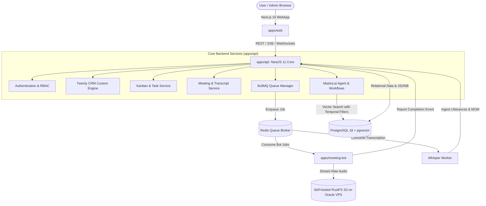

# 01. Architecture and System Overview

## 1. Executive Summary
Kara is an autonomous AI Chief of Staff and Workspace Operating System for teams. It bridges real-time meeting intelligence, automated task management, dynamic CRM modeling, and truthful RAG search.

Unlike the previous prototype (`meera` / `self-attendee`), Kara replaces fragile multi-repo microservices and synchronous Celery queues with an enterprise **Turborepo Monorepo** featuring an asynchronous **BullMQ pipeline**, **Next.js 16 App Router**, **NestJS 11 Core**, **Mastra.ai**, and a **PostgreSQL 18 Native Stack with pgvector**.

---

## 2. Monorepo Structure

```
kara/
|-- apps/
|   |-- web/                     # Next.js 16 (React 19, Tailwind v4, TanStack Query/Table, Zustand)
|   |-- api/                     # NestJS 11 Core + @mastra/nestjs + BullMQ Queues + S3
|   |-- meeting-bot/             # Stateless containerized Chromium bot (Puppeteer/WebRTC)
|-- packages/
|   |-- db/                      # PostgreSQL 18 Database Layer (Drizzle ORM + pgvector)
|   |-- shared-types/            # Shared Zod schemas, TypeScript DTOs, and enums
|   |-- ui/                      # Shared design tokens & Radix UI primitives
|-- docs/                        # Numbered system architecture and feature documentation
|-- .env.example                 # Centralized single-environment configuration
|-- docker-compose.yml           # Optional containerized infra (Redis, PG backup)
|-- pnpm-workspace.yaml          # pnpm workspace package mappings
|-- turbo.json                   # Turborepo task pipeline and caching rules
```

---

## 3. High-Level System Architecture



---

## 4. Why This Architecture Eliminates Previous Bottlenecks

1. **Decoupled Bot Lifecycle**:
   The meeting bot never accesses the primary database directly. It records audio streams directly to S3 (RustFS on Oracle Cloud) and reports lifecycle status through authenticated, idempotent webhooks.
2. **PostgreSQL Native MVCC Eliminates Database Locks**:
   In the previous prototype, SQLite single-writer locking caused `OperationalError: database is locked` whenever multiple workers wrote concurrently. Kara runs on **PostgreSQL 18 Native**, which uses Multi-Version Concurrency Control (MVCC) and row-level locking. Multiple BullMQ workers can concurrently ingest transcripts, synthesize MOMs, and update task statuses without lock contention.
3. **Unified Relational & Vector Store (pgvector)**:
   Instead of running a separate vector database (e.g. Chroma/Qdrant) alongside a relational database and struggling with synchronization and distributed transactions, Kara leverages PostgreSQL 18 with `pgvector`. Transcript utterances and their high-dimensional vector embeddings reside in the same database engine, allowing atomic transactions and hybrid vector + SQL relational filtering.
4. **Batch Ingestion Instead of Per-Utterance Worker Storms**:
   Instead of launching a separate Celery task for every 3-second audio slice, complete meetings or structured audio segments are ingested in single transactional batches.
5. **Single Shared Type System**:
   Any schema change in `@kara/shared-types` propagates instantly across frontend, backend, database layer, and agent tools at compile-time.
